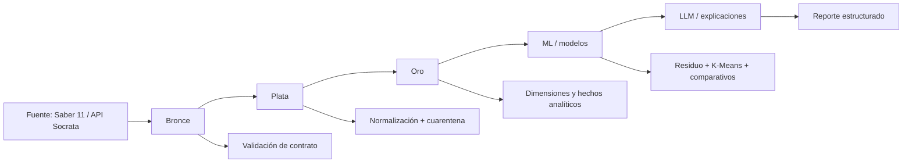

# 🚀 Pipeline ETL BG - Saber 11

<div align="center">


<p>
  <strong>Big Data + IA explicativa para medir el desempeño real de los colegios usando contexto socioeconómico.</strong>
</p>

</div>

## 📌 ¿Qué es este proyecto?

Este repositorio construye un pipeline end-to-end para analizar resultados de Saber 11 y estimar el rendimiento esperado de cada colegio a partir del contexto socioeconómico de sus estudiantes. Luego compara ese valor con la nota real para detectar:

- colegios con mayor necesidad de apoyo,
- establecimientos con desempeño sobresaliente o "modelo",
- grupos de colegios con comportamientos similares,
- diferencias entre modelos predictivos,
- explicaciones comprensibles generadas por LLM sobre indicadores ya calculados.

Es un proyecto de analítica aplicada en educación, construido sobre un stack de datos escalable y reproducible.

---

## 🧭 Visión general del negocio

El problema central es simple pero importante: no basta con mirar el puntaje total; hay que entender qué tan bien está funcionando cada colegio una vez se controla por su contexto.

El pipeline permite responder preguntas como:

- ¿Qué tan lejos está un colegio de su nivel esperado?
- ¿Qué establecimientos están por debajo de lo esperado y requieren intervención?
- ¿Cuáles tienen desempeño superior al de su contexto?
- ¿Qué variables del entorno explican mejor la variación del rendimiento?
- ¿Qué tan útil es una explicación generada por IA frente a los resultados analíticos reales?

---

## 🏗️ Arquitectura del pipeline



## 🔄 Flujo por capas

### 1) Bronce
- ingestión de registros crudos,
- validación de contrato por periodo,
- metadatos de auditoría (`_periodo`, `_ingest_ts`, `_fuente`),
- partición y almacenamiento en Delta.

### 2) Plata
- normalización de tipos y categorías,
- limpieza de columnas clave,
- deduplicación,
- enriquecimiento con DIVIPOLA,
- validación de registros inválidos y separación a cuarentena,
- cálculo de índice socioeconómico.

### 3) Oro
- construcción de esquema estrella,
- dimensiones (`dim_colegio`, `dim_municipio`, `dim_periodo`),
- hechos (`fact_colegio_periodo`, `fact_anomalia`),
- métricas de rendimiento y residuo por colegio.

### 4) ML
- features solo de contexto socioeconómico,
- split agrupado por colegio para evitar fuga de datos,
- comparación de modelos de regresión y aprendizaje automático,
- cálculo de residuos y z-score,
- segmentación con K-Means.

### 5) LLM
- no calcula métricas,
- interpreta resultados ya medidos,
- genera explicaciones estructuradas y comprensibles a partir de cifras del Oro/ML.

---

## 🧠 Stack tecnológico

- Python 3.11
- PySpark
- Delta Lake
- scikit-learn
- PyTorch
- pytest
- YAML para contratos de datos
- Databricks + Unity Catalog

---

## 📁 Estructura del repositorio

```text
.
├── README.md
├── main.py
├── requirements.txt
├── conftest.py
├── sitecustomize.py
├── config/
│   ├── __init__.py
│   ├── settings.py
│   ├── contract_loader.py
│   ├── contracts/
│   └── schemas/
├── pipelines/
│   ├── bronze/
│   ├── silver/
│   └── gold/
├── ml/
│   ├── __init__.py
│   ├── modeling.py
│   └── run_ml.py
├── llm/
│   ├── __init__.py
│   ├── explainer.py
│   └── run_llm.py
├── scripts/
│   ├── check_env.py
│   ├── explore_api.py
│   └── validate_databricks_period.py
├── tests/
│   ├── test_bronze_contract.py
│   ├── test_silver.py
│   ├── test_gold.py
│   ├── test_ml_llm.py
│   └── test_placeholder.py
├── docs/
│   ├── PLAN.md
│   └── data_dictionary.md
├── data/
│   ├── bronze/
│   ├── silver/
│   ├── gold/
│   ├── quarantine/
│   └── raw/
├── notebooks/
└── .env.example (si se agrega según entorno)
```

---

## ⚙️ Requisitos

### Local

- Python 3.11+
- Java JDK compatible con Spark
- Dependencias instaladas desde `requirements.txt`

### Windows

Si ejecutas el proyecto en Windows, puede requerirse setup adicional de Hadoop:

```bash
set HADOOP_HOME=C:\hadoop
```

y tener `winutils.exe` disponible en `C:\hadoop\bin`.

---

## 🚀 Inicio rápido

```bash
python -m venv .venv
.venv\Scripts\activate
python -m pip install -r requirements.txt
python -m pytest -q
```

## 🧪 Ejecutar el pipeline

### Por capa

```bash
python main.py --layer bronze
python main.py --layer silver
python main.py --layer gold
python main.py --layer ml
python main.py --layer llm
```

### Todo el pipeline

```bash
python main.py --layer all
```

---

## 🌐 Variables de entorno

El proyecto detecta automáticamente el entorno local o Databricks y soporta ambos.

```bash
ENVIRONMENT=local
USE_FALLBACK=true
SABER11_DATASET_ID=
SOCRATA_APP_TOKEN=
UNITY_CATALOG=workspace
```

### Significado

- `ENVIRONMENT`: ambiente de ejecución (`local` o `databricks`).
- `USE_FALLBACK`: activa un dataset sintético si no hay fuente real.
- `SABER11_DATASET_ID`: identificador del dataset en la API de datos abiertos.
- `SOCRATA_APP_TOKEN`: opcional, ayuda a evitar rate limits.
- `UNITY_CATALOG`: catálogo destino en Databricks.

---

## ✅ Idempotencia y robustez

El pipeline está pensado para ser reproducible y seguro:

- validación de contrato antes de escribir Bronce,
- particiones por periodo,
- tablas Delta con escritura idempotente,
- registros inválidos movidos a cuarentena,
- `overwrite`/`MERGE` en lugar de operaciones peligrosas sin control,
- respuesta a fallos con fallback local para validación del flujo.

---

## 📈 Qué analiza exactamente

El proyecto combina ciencia de datos, ingeniería y IA explicativa:

- features solo de contexto socioeconómico,
- sin incluir identificadores del colegio ni puntajes de áreas en la etapa predictiva,
- split agrupado por colegio para evitar fuga de datos,
- cálculo de residuo como diferencia entre valor real y esperado,
- z-score del residuo para identificar colegios prioritarios y modelo,
- comparación honesta entre modelos: regresión lineal, Random Forest y MLP,
- segmentación mediante K-Means,
- interpretación textual por LLM a partir de métrica ya calculada.

---

## 📦 Salidas esperadas

El pipeline genera artefactos clave en las rutas de datos:

- `data/bronze`: registros validados por periodo.
- `data/silver`: tablas normalizadas y depuradas.
- `data/gold`: dimensiones y hechos analíticos.
- `data/gold/ml_summary.json`: resumen estadístico y segmentación.
- `data/gold/fact_explicacion.json`: explicación estructurada generada por LLM.

---

## 🧪 Pruebas

```bash
python -m pytest -q
```

La suite cubre validación de contratos, reglas de normalización, capa Gold y verificación del comportamiento de ML/LLM.

---

## 🧩 Convenciones del proyecto

- snake_case para nombres de variables y funciones,
- type hints en Python,
- docstrings en español,
- logging en lugar de `print`,
- separación por capas y runners bien definidos,
- diseño modular y extensible.

---

## 🗺️ Roadmap de progreso

- [x] entorno base y configuración local
- [x] ingesta y validación de Bronce
- [x] normalización y cuarentena en Plata
- [x] esquema analítico en Oro
- [x] modelos de predicción y residuos
- [x] segmentación con K-Means
- [x] explicación con LLM
- [x] orquestación principal del pipeline

---

## 💡 Mensaje final

Este proyecto está pensado para unir ingeniería de datos, analítica predictiva y coordinación de IA explicativa en un único flujo que convierta información pública en decisiones útiles para educación. La idea central es no solo producir métricas, sino generar una visión accionable y comprensible del desempeño escolar.
